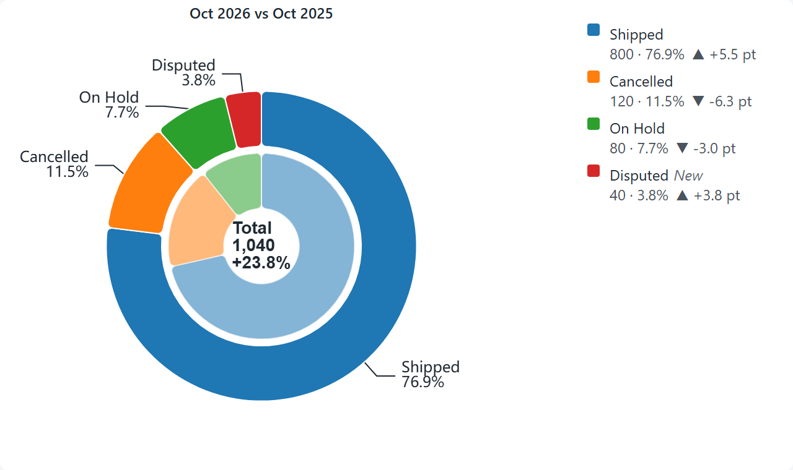
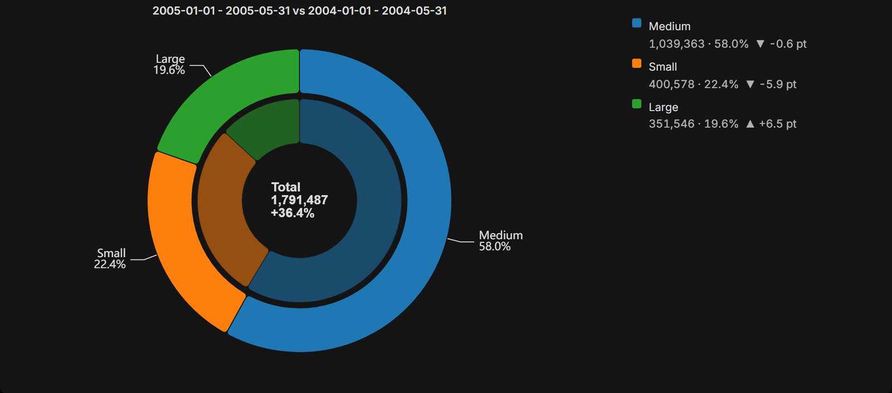
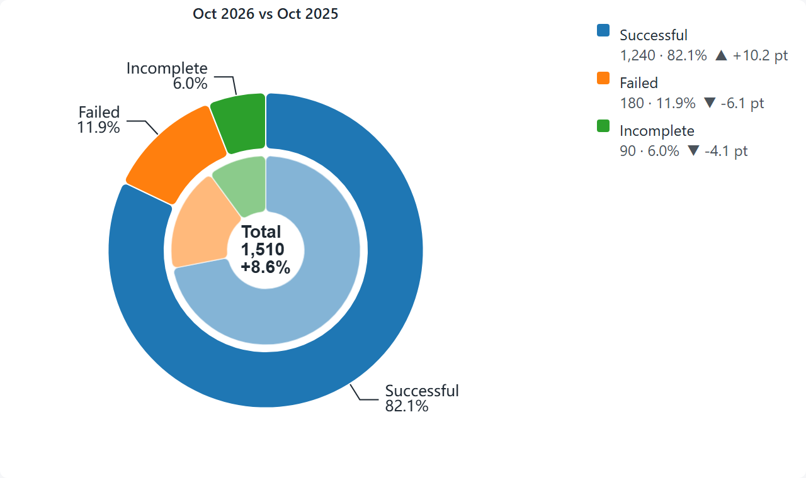

# StratumDonut: double-ring donut for Apache Superset 6.1.0

[](https://opensource.org/licenses/Apache-2.0)
[](https://superset.apache.org/)
[](https://www.typescriptlang.org/)
[](https://echarts.apache.org/)

A chart plugin that compares two periods in a single donut. The outer ring is the reference period and the inner ring is the comparison period. Each slice shows its value, share, change in share points and percentage change, with an interactive legend.

The comparison period comes from the native **PeriodCompare** filter (see `superset-period-compare`), or from a preset chosen in the chart (previous period, previous year, custom range).

## 📸 Visual Preview



*Sales by deal size on Superset's example sales data, January to May 2005 against the same months of 2004. Screenshots are real charts in Chrome.*

### 🌙 Dark theme

Text, labels and borders follow the Superset theme.



### 🎯 Metrics mode with "lower is better" slices

Each metric becomes a slice. Slices can be marked as "lower is better", so that a decrease is shown as positive.



## 🌟 Features

- **Slices from a column** (one slice per dimension value) or **from metrics** (one slice per metric, e.g. successful, failed, incomplete).
- **Comparison from several sources**: dashboard filter, chart preset, or no comparison. When the reference period is relative (e.g. "Last month") the comparison uses a native shift.
- **Two queries with the same columns and metrics**: only the time window changes. Slices present in one period only are kept and marked as new or missing.
- **Other**: slices below a threshold, or beyond the top N, are grouped into "Other", using the same group on both rings.
- **Row limit**: if a query is truncated, the shares are approximate and the panel says so. Enable "Exact total" (column mode only) for the real total.
- **Polarity**: for each slice you choose whether a positive change is good, bad or neutral (e.g. failed bookings: lower is better).
- **Interactions**: click a slice for the dashboard cross-filter, right click for drill to detail.
- **Theme**: text and labels follow the Superset theme.
- **Number formats**: values use the en-US format by default (`1,240.5`), and the value format can be changed in the panel.

## 🔗 Cross-filtering: how to turn it on

1. **In the chart** (Explore, section *Interaction*/*Cross-filtering*): the option **Enable cross-filtering** is on by default. Turn it off to stop the chart from filtering the others.
2. **On the dashboard**: cross-filtering is enabled by default in Superset 6 (feature flag `DASHBOARD_CROSS_FILTERS`). Open the filter bar and its *Cross-filters* tab to choose which charts a filter reaches.
3. **Use it**: In *column* mode, click a slice to filter the other charts by that value (the slice is the value of the column you group by). In *metrics* mode slices are metrics, not values, so there is nothing to filter by. The other charts reload and show a filter badge in their header.
4. **Clear it**: click the same item again, or use *Clear all* in the filter bar.

The other charts must have the filtered column in their dataset: a chart without it ignores the filter.

## 🎛️ Control panel

No JSON to write by hand.

- **Data**: mode, metric or metrics, dimension, filters, time column, comparison source and preset.
- **Customize**: periods and labels, rings (radius, width, gap, start angle), labels (content, position, threshold), slices (name, color, visibility, polarity, format, through a per-slice control), grouping and order, legend, center text, tooltip, change and formats.

## 🚀 Installation

From the plugin folder, with a checkout of Superset 6.1.0:

```powershell
.\install-plugin.ps1 -SupersetPath C:\path\to\superset
```

The script copies the plugin into `superset-frontend/plugins/`, registers `StratumDonutChartPlugin` in `MainPreset.ts` (idempotent, with a `.bak` backup) and adds the missing dependencies to `package.json`. Then rebuild the Superset frontend and restart.

## 🛠️ Development

```powershell
npm install
npm run build      # bundle into dist/
npm test           # unit tests
```

To see the chart without Superset, the dev studio in `dev-studio/` runs the real plugin code with sample scenarios:

```powershell
cd dev-studio
npm install
npx vite --port 5174
```

The dev studio also has an embed mode that renders only the chart, used to create the images in this README:

```text
http://127.0.0.1:5174/?scenario=column-basic&embed=1&width=640&height=380
```

## 📁 Repository structure

- `src/plugin/`: buildQuery (two queries), queryPlan (query indexes), transformProps (data and style), controlPanel (panels), controls/sliceConfig (per-slice control).
- `src/utils/`: comparison (choice of the comparison), dates and periodLabel (period labels), merge (joining the periods, Other, rest), model (data model), format, style, echartsOption (ECharts option), crossFilter.
- `src/components/`: StratumDonutChart (chart and interactions), RichLegend (legend).
- `test/`: unit tests for dates, comparison, merge, model, formats, ECharts option, control panel and cross-filter.

## ⚠️ Known limitations

- Drill by is not included: the context menu offers drill to detail only.
- When a period is truncated, the shares of the other period are approximate (see the notice).
- The full visual check in a Superset clone with PeriodCompare is still pending.
